<div align="center">


# Proxy Management Extension by FlashProxy

**Switch between your FlashProxy plans and proxies from any provider, with per-site rules.**

A Manifest V3 extension for Chrome, Brave, Edge and other Chromium browsers.

[](https://github.com/flashproxy-web/proxy-extension/actions/workflows/ci.yml)
[](LICENSE)


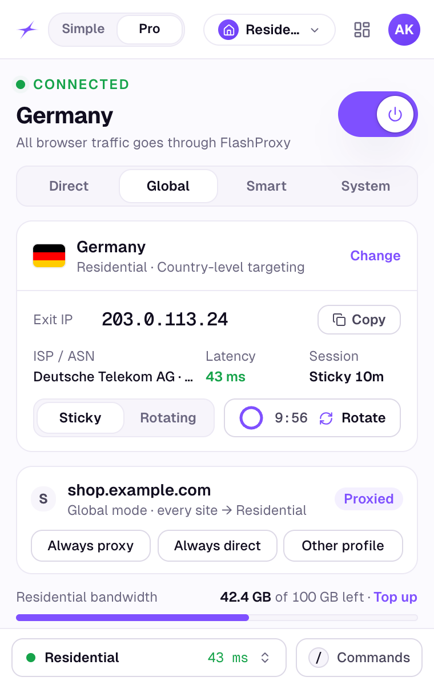
&nbsp;&nbsp;
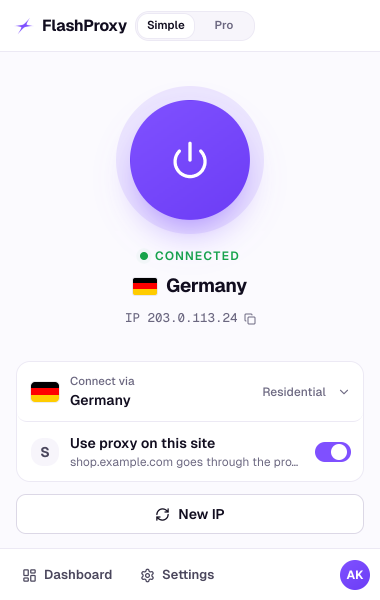

</div>

## Features

- **FlashProxy plans, built in.** Paste an API key from your FlashProxy account and your Residential, ISP, Datacenter and Mobile plans show up with their data left, locations and renewal dates.
- **Any other provider too.** Add HTTP, HTTPS and SOCKS proxies from any provider (Chromium can't send a login to a SOCKS proxy, so those need an IP allowlist), or bulk-import a list in the common formats. The extension recognises well-known providers from the host name.
- **Pools.** Group proxies and pick round-robin, random, lowest latency or failover.
- **Four modes.** Direct, Global (everything through the proxy), Smart (only the sites your rules match) and System.
- **Per-site rules.** Domain, wildcard, regex and IP-range rules send a site through a plan, one of your proxies, a pool, direct, or block it. A rule whose proxy can't be reached blocks the site instead of leaking it.
- **Location and sessions.** Pick a country, keep a sticky session or rotate, and get a new IP in one click.
- **Health checks.** Exit IP, ISP and latency on connect, a test for every proxy, and a fix-it message when something fails.
- **Two popup layouts.** Simple (one power button) for most people, Pro for everything above. Light and dark themes.

## Screenshots

<table>
  <tr>
    <td align="center">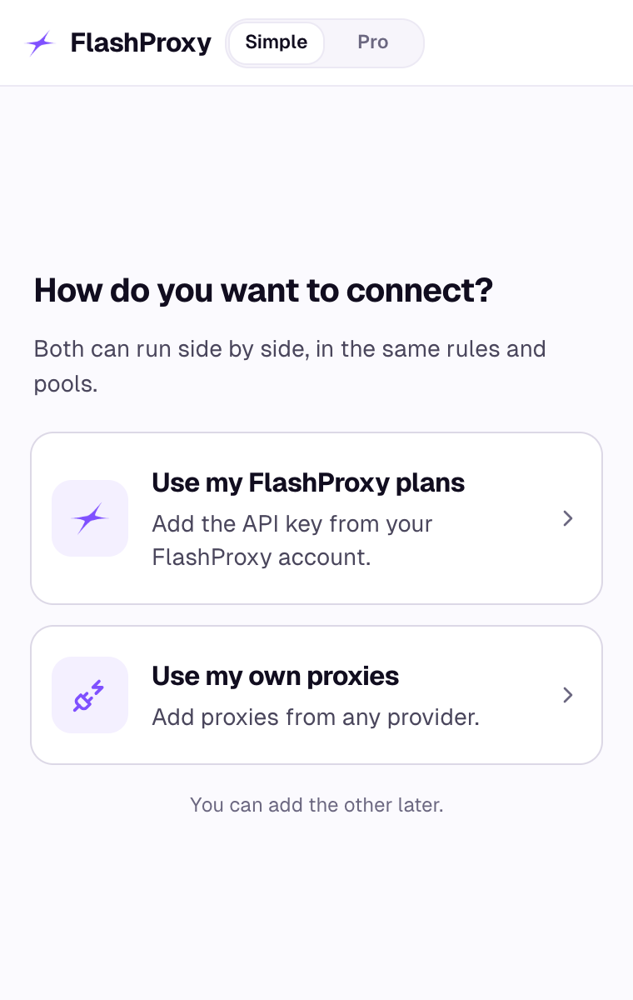<br><sub>First run</sub></td>
    <td align="center">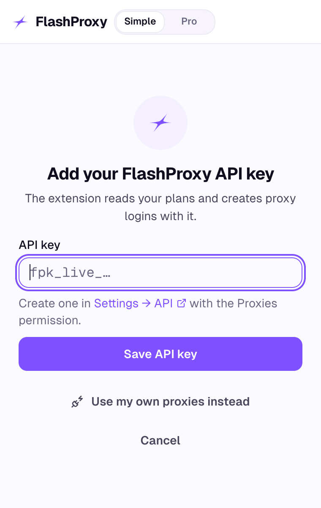<br><sub>Add your API key</sub></td>
    <td align="center">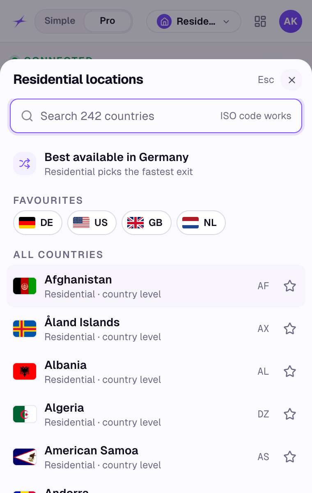<br><sub>Locations and favourites</sub></td>
  </tr>
  <tr>
    <td align="center"><br><sub>Smart mode with rules</sub></td>
    <td align="center">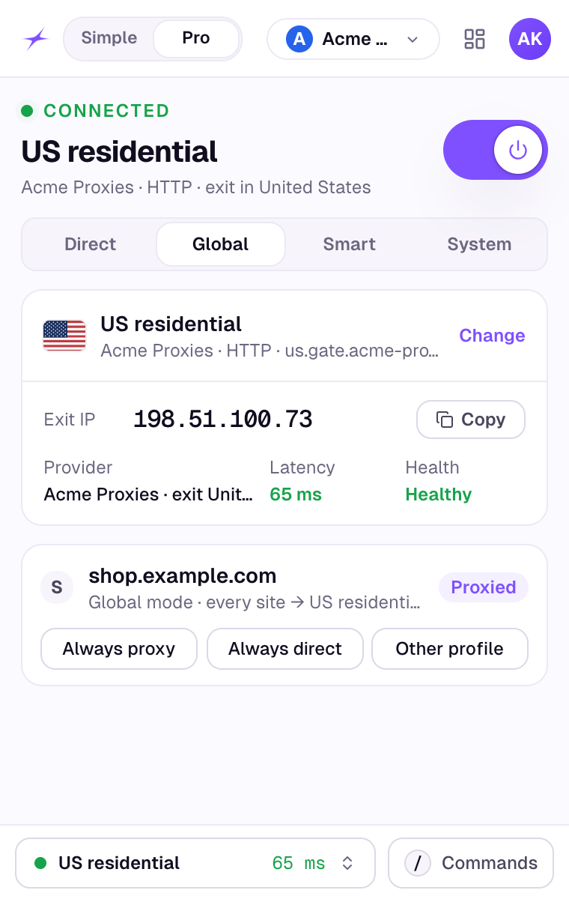<br><sub>Your own proxy</sub></td>
    <td align="center">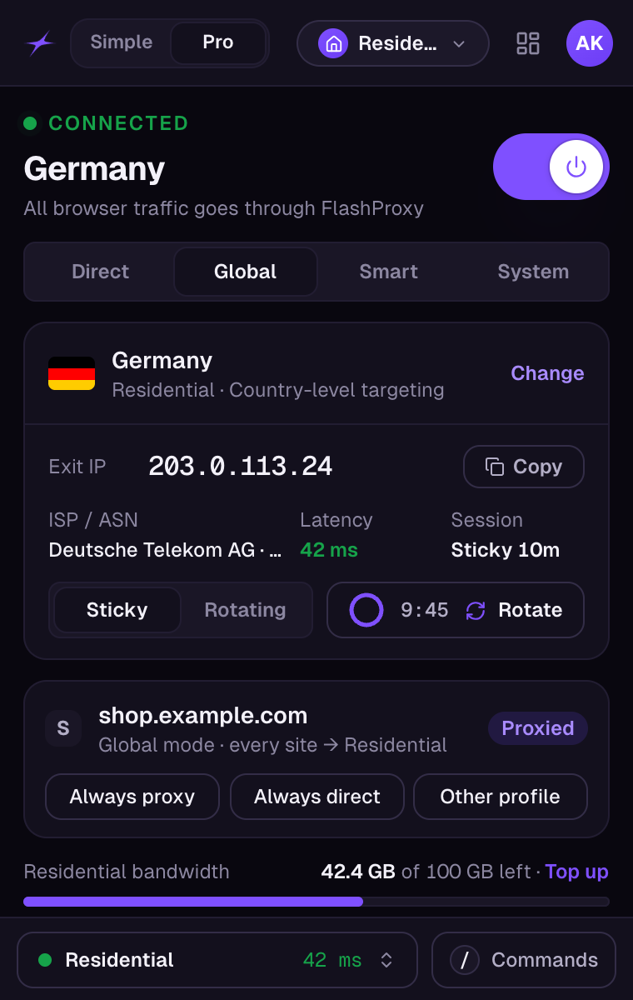<br><sub>Dark theme</sub></td>
  </tr>
</table>

<table>
  <tr>
    <td align="center">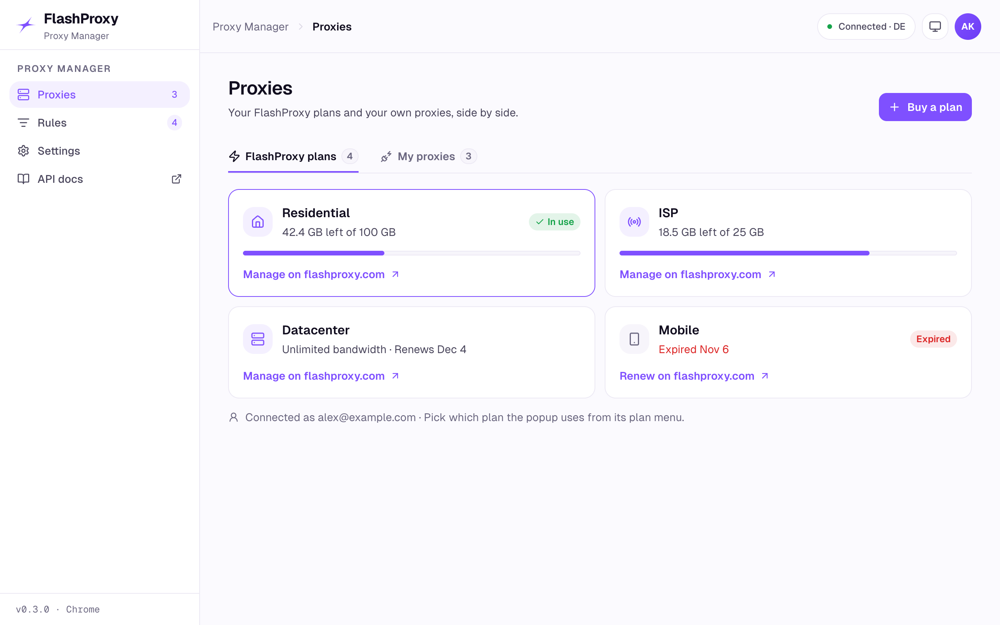<br><sub>FlashProxy plans</sub></td>
    <td align="center">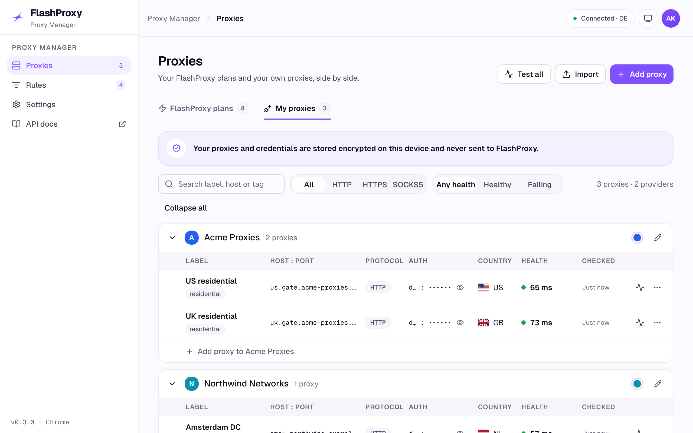<br><sub>Your proxies, grouped by provider</sub></td>
  </tr>
  <tr>
    <td align="center"><br><sub>Add a proxy</sub></td>
    <td align="center">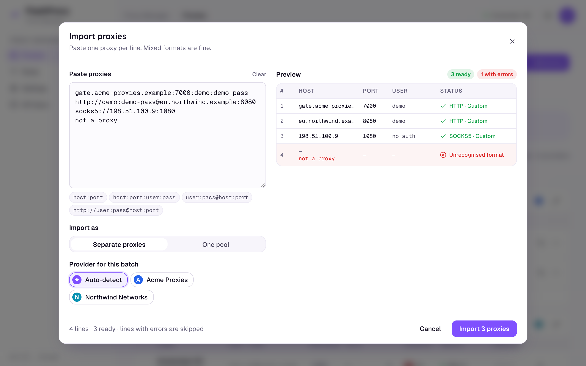<br><sub>Bulk import with preview</sub></td>
  </tr>
  <tr>
    <td align="center">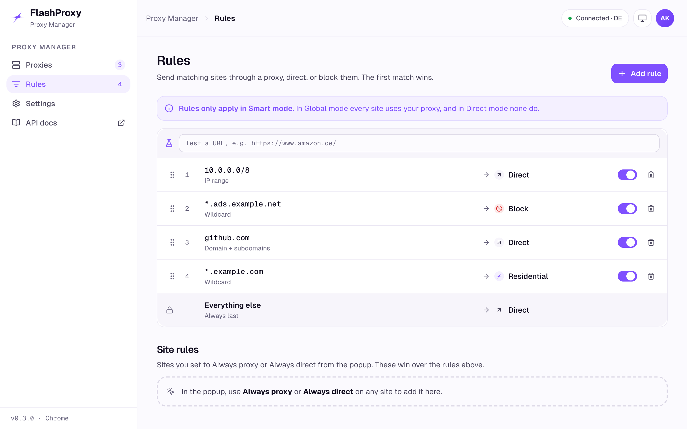<br><sub>Rules, with a URL tester</sub></td>
    <td align="center"><br><sub>Dark theme</sub></td>
  </tr>
</table>

The screenshots come from the real extension, driven by `npm run shots` against a local mock of the FlashProxy API. Every account, address and host in them is made up.

## Install

The extension isn't in the Chrome Web Store yet. To install it from source:

1. Install [Node.js](https://nodejs.org/) 22 or newer.
2. Build it:

   ```bash
   git clone https://github.com/flashproxy-web/proxy-extension.git
   cd proxy-extension
   npm install
   npm run build
   ```

3. Open `chrome://extensions` (`brave://extensions` in Brave, `edge://extensions` in Edge), turn on **Developer mode**, click **Load unpacked** and choose the `dist` folder.
4. Pin the extension from the puzzle-piece menu in the toolbar.

## Getting started

**With a FlashProxy account.** On [flashproxy.com](https://www.flashproxy.com), open **Dashboard → Settings → API** and create a key with the **Proxies** permission. Paste it into the popup (or the extension's **Settings** page) and your plans load. Pick a location and press the power button.

**With proxies from another provider.** Choose **Use my own proxies** in the popup, or open the dashboard and click **Add proxy** or **Import**. No account is needed.

You can use both side by side: rules can send one site through a FlashProxy plan and another through your own proxy.

## Privacy and permissions

Your FlashProxy API key and your proxy logins are stored on your device, encrypted with AES-GCM under a key that can't be exported from the browser. The API key is only sent to flashproxy.com, and your own proxies and their logins are never sent to FlashProxy. There is no analytics or tracking in the extension.

| Permission                             | Why                                                                                                                   |
| -------------------------------------- | --------------------------------------------------------------------------------------------------------------------- |
| `proxy`                                | Points the browser at the proxy you picked, or installs the PAC script for Smart mode.                                |
| `webRequest`, `webRequestAuthProvider` | Answers the proxy's login prompt, so you aren't asked for the password on every site.                                 |
| `<all_urls>` (host access)             | Needed for the proxy login on any site you visit through the proxy.                                                   |
| `storage`                              | Keeps your settings, proxies and rules.                                                                               |
| `alarms`                               | Renews sticky sessions, refreshes your plans and runs health checks.                                                  |
| `activeTab`                            | Shows the current site's rule in the popup.                                                                           |
| `browsingData`                         | Clears the cookies a proxy gateway set for a previous login when you switch to a different login on the same gateway. |

The extension talks to these services:

| Host                        | When                                                                                                                              |
| --------------------------- | --------------------------------------------------------------------------------------------------------------------------------- |
| `www.flashproxy.com`        | With an API key only: loads your plans and creates proxy logins (`/api/v1`).                                                      |
| `ipinfo.io`, `v6.ipinfo.io` | After you connect, through the proxy, to show the exit IP, ISP and location. After you disconnect, directly, to show your own IP. |
| `cp.cloudflare.com`         | Measures latency through the proxy.                                                                                               |
| `api.country.is`            | Tests a proxy, and is the fallback when ipinfo.io doesn't answer.                                                                 |

## Development

```bash
npm install
npm run dev      # pages in a normal tab: http://localhost:5173/popup.html
```

The dev server serves `popup.html`, `dashboard.html?page=proxies&tab=own` (`page` is `proxies`, `rules` or `settings`) and `welcome.html`. Outside the extension they show an empty state. Build with `npm run build` and load `dist` to try the real thing. `VITE_FP_WEB` (see `.env.example`) points the build at another FlashProxy server and defaults to `https://www.flashproxy.com`.

| Script                             | What it does                                                                                                                                                                                                                                              |
| ---------------------------------- | --------------------------------------------------------------------------------------------------------------------------------------------------------------------------------------------------------------------------------------------------------- |
| `npm run build`                    | Typecheck, then build the extension into `dist/`.                                                                                                                                                                                                         |
| `npm test`                         | `pac-check`, a build and the end-to-end suite.                                                                                                                                                                                                            |
| `npm run pac-check`                | Checks the generated PAC script against the TypeScript rule matcher, including hosts and rules that try to break out of their strings.                                                                                                                    |
| `npm run e2e`                      | Loads `dist` in headless Chrome for Testing (downloaded into `.cache/` on first run) with local test proxies: connecting, wrong passwords, proxy tests, Smart-mode rules, import and undo, and logins surviving a browser restart. Needs internet access. |
| `npm run lint`, `npm run lint:fsd` | ESLint, and the [Feature-Sliced Design](https://fsd.how/) layer check.                                                                                                                                                                                    |
| `npm run typecheck`                | TypeScript only.                                                                                                                                                                                                                                          |
| `npm run shots`                    | Rebuilds the screenshots in `docs/screenshots` (needs `openssl`).                                                                                                                                                                                         |

### Project structure

| Path                                           | Role                                                                                                                                                                                                                                                      |
| ---------------------------------------------- | --------------------------------------------------------------------------------------------------------------------------------------------------------------------------------------------------------------------------------------------------------- |
| `src/background/`                              | The service worker: the stored API key (`api/apiKey.ts`), the FlashProxy API client (`api/flashproxy.ts`), plans (`account.ts`, `plans.ts`), connecting and rotating (`connection.ts`), and `chrome.proxy`, proxy logins and the exit probe (`proxy.ts`). |
| `src/popup/`, `src/dashboard/`, `src/welcome/` | The three pages. Each is its own Feature-Sliced Design tree (`app`, `pages`, `widgets`, `entities`, `shared`).                                                                                                                                            |
| `src/shared/`                                  | Domain types, the page client and messages to the service worker, config, the UI kit (shadcn/ui on Radix) and styles.                                                                                                                                     |
| `e2e/`, `scripts/`                             | The end-to-end suite and its test proxy, the PAC check, the build and the screenshot script.                                                                                                                                                              |

Built with React 19, TypeScript, Vite, Tailwind CSS 4, shadcn/ui and the React Compiler.

## Contributing

Bug reports, ideas and pull requests are welcome. Read [CONTRIBUTING.md](CONTRIBUTING.md) first, and the [code of conduct](CODE_OF_CONDUCT.md). Please don't post API keys or proxy passwords in issues.

To report a security problem, use a [private security advisory](https://github.com/flashproxy-web/proxy-extension/security/advisories/new), not a public issue. See [SECURITY.md](SECURITY.md).

## License

Copyright (C) 2026 FlashProxy.

This program is free software: you can redistribute it and/or modify it under the terms of the GNU General Public License, version 3, as published by the Free Software Foundation. See [LICENSE](LICENSE). The FlashProxy name and logo are not covered by the license.

The bundled Geist fonts are under the SIL Open Font License (`src/assets/fonts/LICENSE.TXT`).
