# Proxy Management Extension by FlashProxy

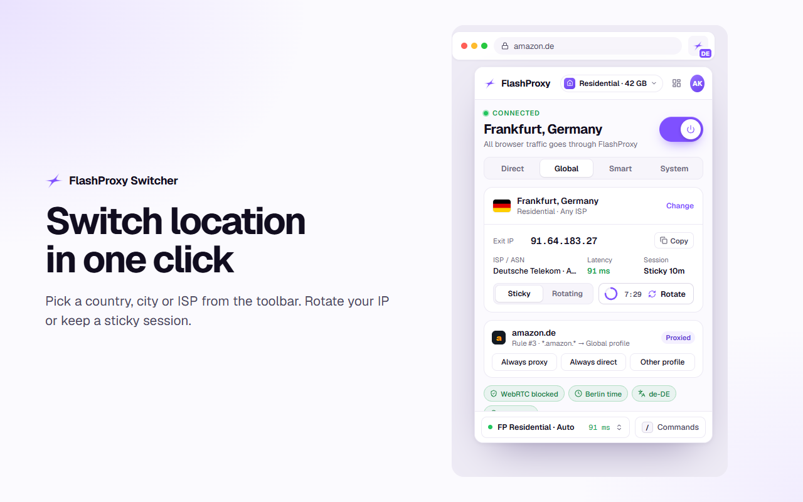

A Manifest V3 browser extension for Chrome and other Chromium browsers (Brave, Edge) that switches between your [FlashProxy](https://www.flashproxy.com) plans and proxies from any other provider, with per-site rules. React + TypeScript + Vite. It has three surfaces:

- **Toolbar popup**, in two layouts the user switches between in its header:
  - **Simple** (default for new users): power button, Connect via (locations and own proxies in one list), Use proxy on this site, New IP.
  - **Pro**: modes, location picker, sticky/rotating sessions, the site card, `/` commands, account menu.
- **Dashboard** (`dashboard.html`, also the options page): Proxies, Rules, Settings.
- **Welcome page** (`welcome.html`): opens once on install. It covers pinning, adding the API key and the Simple/Pro choice.

**FlashProxy plans and own proxies.** The background service worker (`src/background/`) uses the customer's own FlashProxy API key (created in Settings → API on flashproxy.com, with the Proxies permission; the extension checks the permission with `GET /api/v1/key` before saving it and keeps the key sealed like own-proxy logins), loads plans and locations from `/api/v1`, and connects through them: it requests a gateway from `POST /api/v1/plans/{id}/proxies` for the chosen country and session type, applies it with `chrome.proxy`, answers the gateway's auth challenge, and checks the exit IP. Rotate, sticky-session renewal, location and session changes, Global/Smart/Direct modes, per-site rules and health checks all work. Own proxies work without signing in: add, edit, duplicate, move, delete with undo, bulk import, pools with round-robin/random/lowest-latency/failover, Next proxy, and tests that route only `api.country.is` through the proxy under test. Their logins are sealed with AES-GCM using a non-extractable key kept in IndexedDB. In Smart mode the Rules page routes traffic: domain, wildcard, regex and IP-range rules send a site to a FlashProxy plan, an own proxy or pool, Direct or Block. Popup site rules win, everything else goes direct, and a rule whose proxy can't be reached blocks the site instead of leaking it. HTTP calls go through axios. Identity protection isn't wired yet. Opened outside the extension, the pages fall back to an empty snapshot.

## Screenshots

Taken from the earlier dev preview with sample data, before the business logic was removed. The current build shows each screen's empty state instead.

### Popup

<table>
  <tr>
    <td align="center">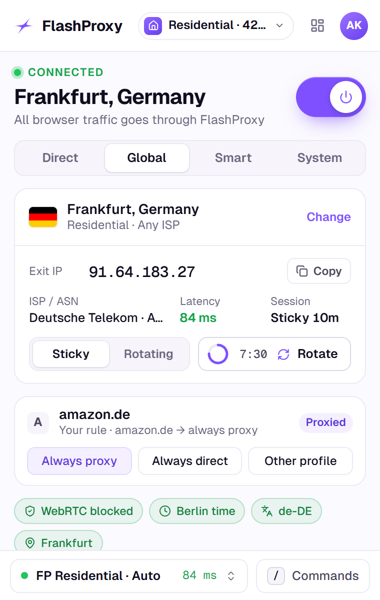<br><sub>Connected · Global</sub></td>
    <td align="center">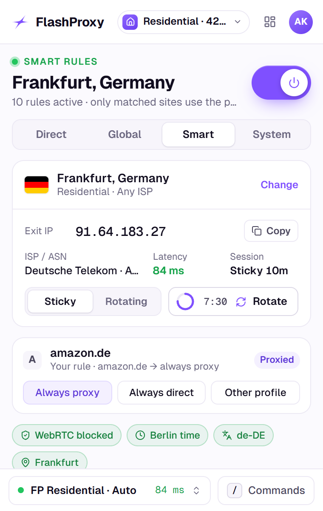<br><sub>Smart mode (rules)</sub></td>
    <td align="center"><br><sub>Locations + favourites</sub></td>
    <td align="center"><br><sub>Own proxy</sub></td>
  </tr>
  <tr>
    <td align="center"><br><sub>First run</sub></td>
    <td align="center">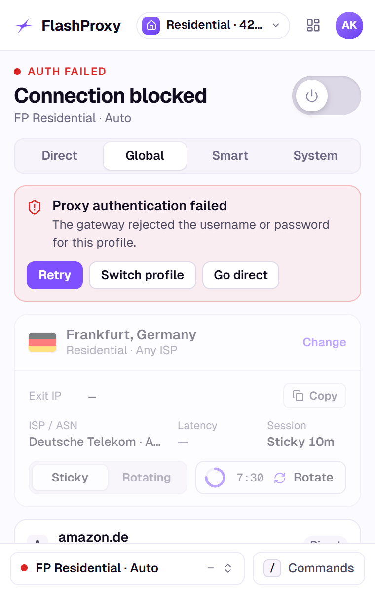<br><sub>Error state</sub></td>
    <td align="center"><br><sub>Dark theme</sub></td>
  </tr>
</table>

### Dashboard

<table>
  <tr>
    <td align="center"><br><sub>FlashProxy plans</sub></td>
    <td align="center"><br><sub>Own proxies, grouped by provider</sub></td>
  </tr>
  <tr>
    <td align="center">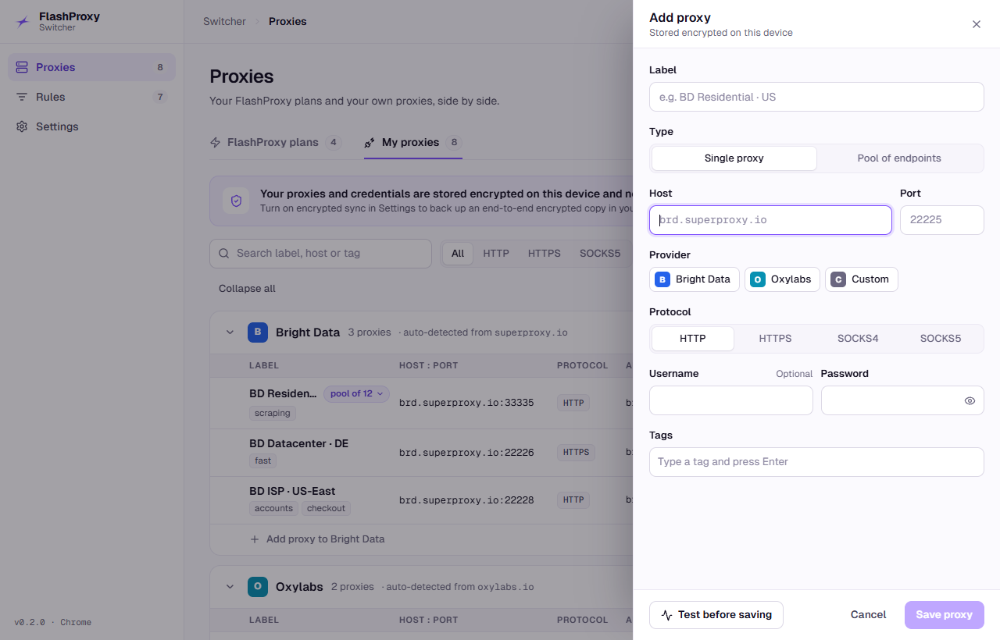<br><sub>Add proxy (detects the provider, tests before saving)</sub></td>
    <td align="center"><br><sub>Bulk import with preview</sub></td>
  </tr>
  <tr>
    <td align="center"><br><sub>Rules, with a URL tester</sub></td>
    <td align="center">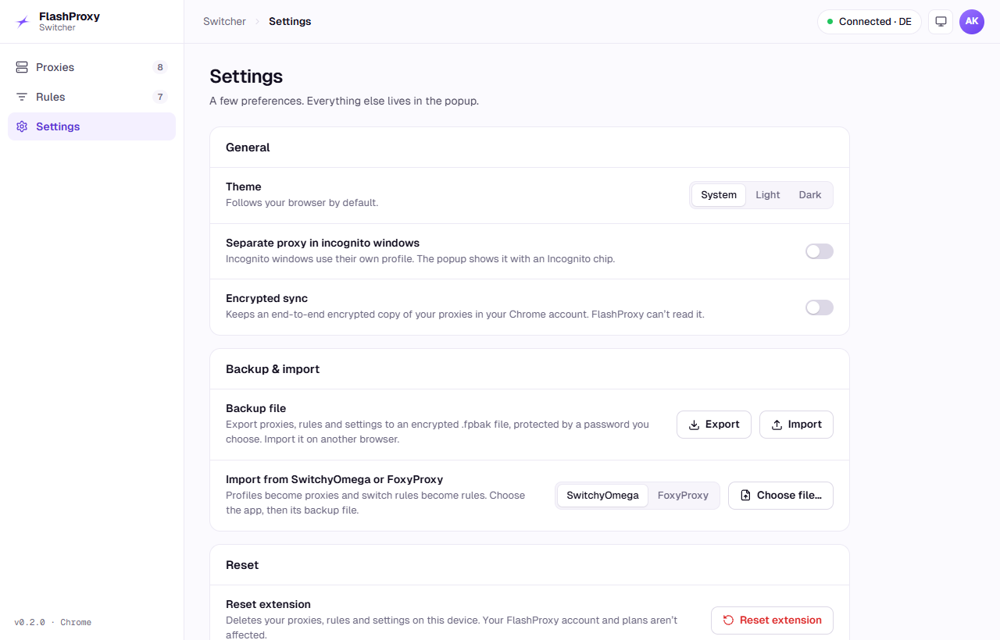<br><sub>Settings: theme and popup layout</sub></td>
  </tr>
  <tr>
    <td align="center">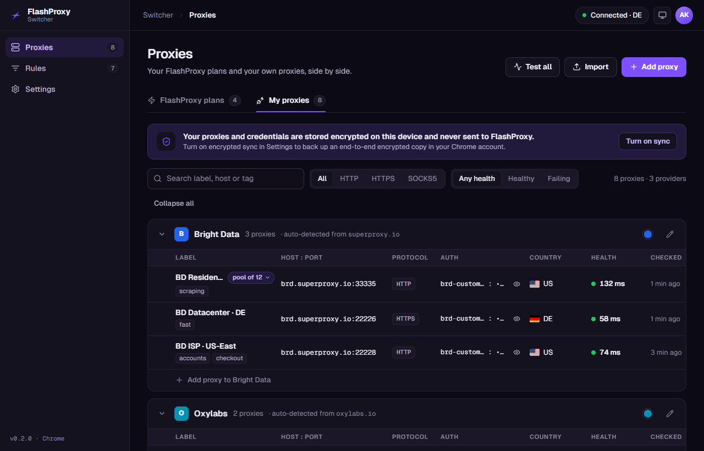<br><sub>Dark theme</sub></td>
    <td align="center">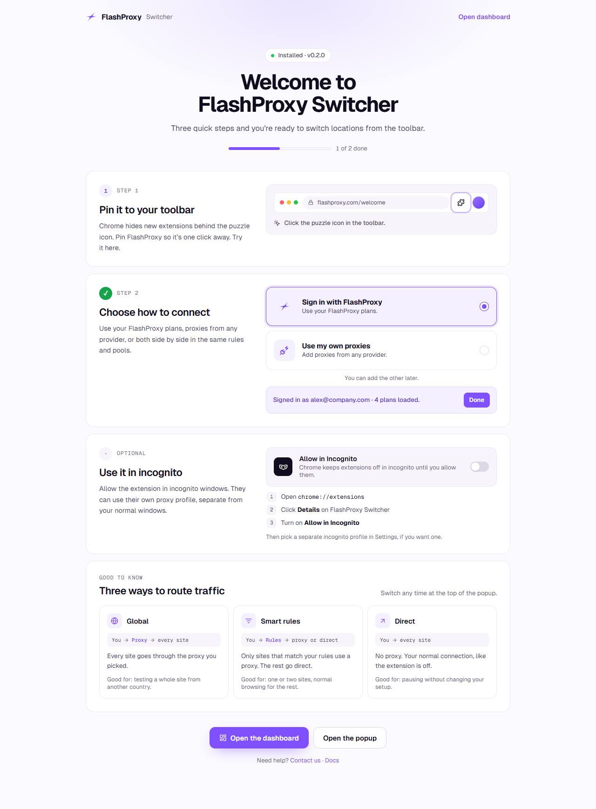<br><sub>Welcome page (opens on install)</sub></td>
  </tr>
</table>

### Chrome Web Store assets

<table>
  <tr>
    <td>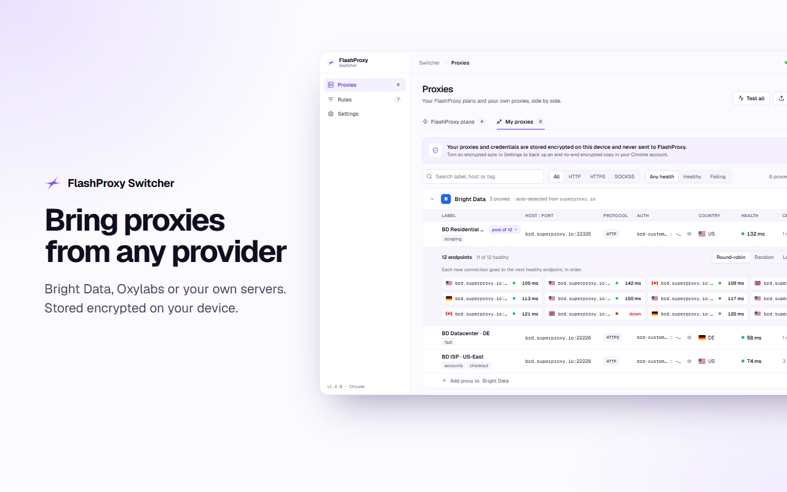</td>
    <td>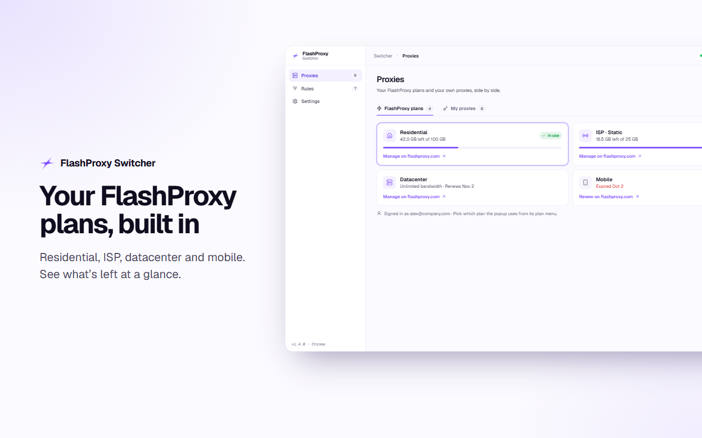</td>
  </tr>
  <tr>
    <td>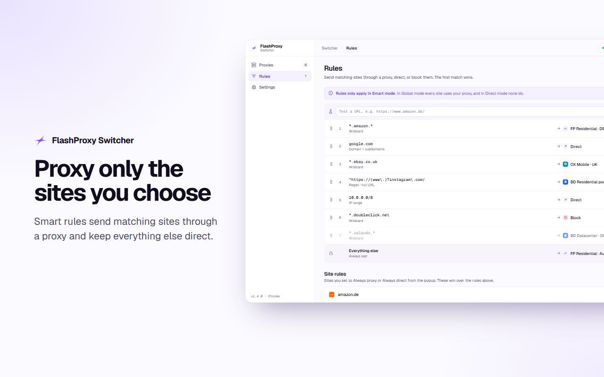</td>
    <td>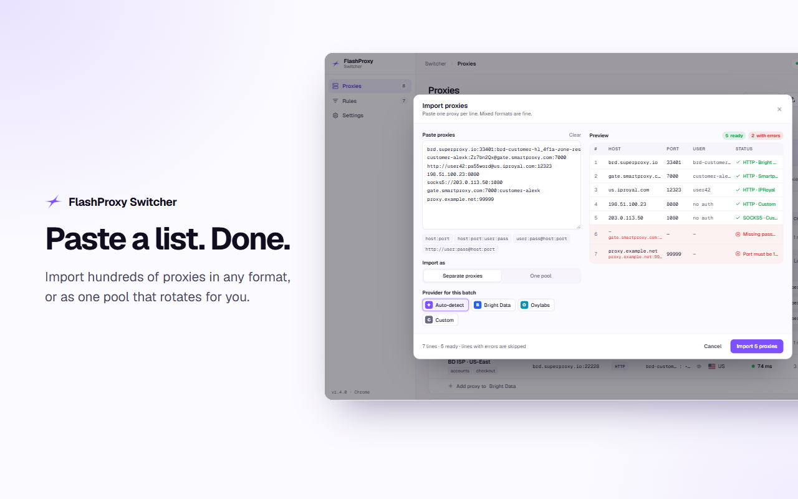</td>
  </tr>
  <tr>
    <td align="center">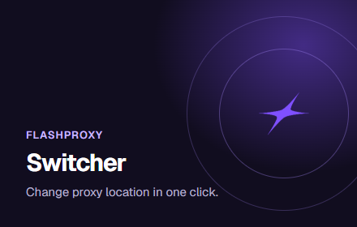<br><sub>Promo tile 440×280</sub></td>
    <td align="center"><br><sub>Store icon 128×128</sub></td>
  </tr>
</table>

## Build and load

```bash
npm install
cp .env.example .env
npm run build
```

`VITE_FP_WEB` in `.env` is optional and defaults to `https://www.flashproxy.com`. No other configuration is needed: users paste their API key into the popup or the dashboard's Settings page.

Then open `chrome://extensions`, enable Developer mode, choose **Load unpacked** and pick `dist/`.

## Tests

```bash
npm test
```

`npm run pac-check` runs the generated PAC script against the TypeScript rule matcher, including hosts and site rules that try to break out of their strings. `npm run e2e` loads `dist/` in Chrome for Testing (downloaded into `.cache/` on first run) with two local test proxies and checks connecting, wrong passwords on a shared gateway, proxy tests, Smart-mode rules, import and undo, bundled flags, and that tabs keep their proxy login after a browser restart. It needs internet access. `npm test` runs both around a build.

## Dev server

```bash
npm run dev
```

The pages also run in a normal browser tab: `http://localhost:5173/popup.html`, `/dashboard.html?page=proxies&tab=own` (`page` = `proxies | rules | settings`) and `/welcome.html`.

## How it works

| Path | Role |
|---|---|
| `src/popup/`, `src/dashboard/`, `src/welcome/` | The three extension pages. Each is its own [Feature-Sliced Design](https://fsd.how/) tree (`app`, `pages`, `widgets`, `entities`, `shared`), checked by `npm run lint:fsd`. |
| `src/background/` | Service worker: the stored API key (`api/apiKey.ts`), the FlashProxy API client (`api/flashproxy.ts`), plan loading (`account.ts`, `plans.ts`), connecting and rotating (`connection.ts`), and `chrome.proxy` + proxy auth + exit probe (`proxy.ts`). |
| `src/shared/api/` | The page client (a snapshot port plus action and RPC messages, falling back to `EMPTY_SNAPSHOT` outside the extension) and the `EngineApi` type the pages call. |
| `src/shared/lib/` | Formatting, flags and country names, plus fallback versions of the routing, import and plan helpers that return neutral results. |
| `src/shared/` | Domain types (`model`), config, the UI kit (`ui`) and styles. |

## Contributing

Issues and pull requests are welcome. Before opening a pull request, run `npm run lint`, `npm run lint:fsd` and `npm test`.

## License

Copyright (C) 2026 FlashProxy.

This program is free software: you can redistribute it and/or modify it under the terms of the GNU General Public License, version 3, as published by the Free Software Foundation. See [LICENSE](LICENSE). The FlashProxy name and logo are not covered by the license.

The bundled Geist fonts are under the SIL Open Font License (`src/assets/fonts/LICENSE.TXT`).
